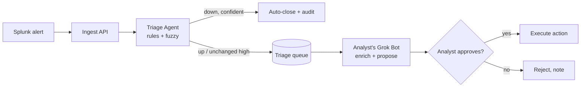

# Agentic Triage for legacy SIEMs (Splunk)

> Phase 1 deliverable: **design pack + contracts**. No application code yet beyond contract stubs.
> Build challenge for SpaceX-SI Field Engineering / Solutions Architect, demo Mon 23 Nov 2026.

## What it does

A legacy on-prem **Splunk** fires an alert through its Webhook alert action. Our **Triage Agent** re-scores
the severity Splunk assigned, using **deterministic rules** first and **AI fuzzy matching** second
(pgvector similarity against past incidents, known patterns and benign baselines, plus an LLM judge).

* **Severity goes up:** candidate label + **Evidence Pack** + **Suggested Next Steps Pack**, then queued for human-assisted triage.
* **Severity goes down:** auto-handled (auto-closed with an audit record, one click to re-open). Low-confidence or guarded downgrades go to a review queue instead.
* **Unchanged:** medium and above go to the queue at standard priority; below medium is recorded and closed.

For the escalated queue each SOC analyst is **10x-ed by a Grok Bot routine** that runs on their behalf:
it claims the newest cases assigned to them, enriches them, drafts comms and **proposes** actions. Only the
analyst can **approve**. That rule is enforced in the OpenAPI contract, the API and the JSON Schema.



## How the team is organised

Seven roles, each owning code **and** contracts: Architect/Tech Lead, Backend, Triage-Agent/ML, Frontend,
Data/DB, QA/contract-test, DevOps. See [docs/team.md](docs/team.md) for the ownership matrix and definitions
of done, and [docs/plan.md](docs/plan.md) for milestones M0-M5 and 25 tickets (also as
[plan/issues.json](plan/issues.json), ready for `gh issue create`).

Work is **contract-first** ([ADR-0007](docs/adr/0007-contract-first-development.md)): contracts were fixed
before any code, so the console builds against a Prism mock, the agent against mocked AI, and the API
against the schemas, all in parallel.

## Repo layout

```
contracts/
  openapi.yaml               OpenAPI 3.1 for the backend API (ingest, cases, queue, actions, bot)
  schemas/*.schema.json      JSON Schema 2020-12: Alert, TriageDecision, EvidencePack, NextStepsPack,
                             Case, AuditEvent, ProposedAction, SplunkWebhookPayload, common
  examples/*.json            positive examples (<schema>[.<Def>].<variant>.json)
  examples/invalid/*.json    negative examples that must fail (pin invariants)
  agent/interfaces.py        triage agent Protocols: RulePlugin, FuzzyMatcher, LLMClient, RoutingPolicy, mocks
  agent/README.md            agent I/O, pipeline, mocking, non-functional contract
docs/
  team.md                    roles, ownership boundaries, contracts owned/consumed, DoD
  plan.md                    milestones, dependency graph, tickets (generated section)
  testing.md                 contract-first test strategy + CI outline
  architecture/              C4 context + containers, components per service, deployment
  adr/                       0001-0008 architecture decision records
  uml/                       user journeys, sequences, state machines, ER diagram
  rendered/                  every mermaid block rendered to SVG
plan/tickets.yaml            source of truth for tickets -> plan/issues.json
scripts/validate_contracts.py  the contract gate (CI-blocking)
scripts/gen_issues.py        regenerate issues.json + plan.md tickets
scripts/render_mermaid.sh    render docs mermaid to SVG
.github/workflows/contracts.yml  CI: contract gate + mermaid render
```

## Run the contract tests

```bash
make contracts          # creates .venv, installs requirements-dev.txt, runs scripts/validate_contracts.py
# or
python3 -m venv .venv && .venv/bin/pip install -r requirements-dev.txt
.venv/bin/python scripts/validate_contracts.py
```

The gate checks: schemas are valid; every example validates; every invalid example is rejected;
OpenAPI 3.1 is valid with external `$ref`s resolved plus house lint (approve/reject analyst-only,
bot endpoints bot-key-only); the agent interface imports and its routing policy and `combine_severity`
reproduce the example decisions; `plan/issues.json` is in sync.

Render diagrams (needs `@mermaid-js/mermaid-cli`): `make diagrams` (set `MMDC=` and `CHROME_PATH=` if needed).

## Where to start reading

1. [System context and containers](docs/architecture/system-context.md)
2. [Escalation sequence](docs/uml/seq-escalate.md) and [Grok Bot routine sequence](docs/uml/seq-grokbot-routine.md)
3. [ADR-0005 severity re-scoring and routing](docs/adr/0005-severity-rescoring-and-routing-policy.md)
4. [ADR-0006 Grok Bot + human approval](docs/adr/0006-grok-bot-routines-and-human-approval.md)
5. [contracts/openapi.yaml](contracts/openapi.yaml)
