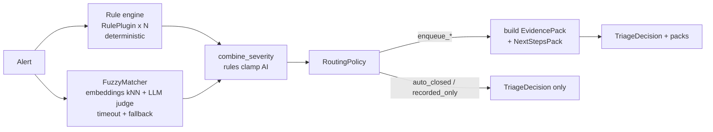

# Triage Agent internal contract

Owner: **Triage-Agent/ML engineer**. Consumers: Backend worker (calls `TriageAgent.triage`), QA (golden tests).

The agent is a library invoked by the backend's triage worker, not a separate network service in v1
(see ADR-0002). That keeps the AI seam *in-process and mockable* while the wire contract stays the
JSON Schemas.

## Input / output

| | Shape | Schema |
|---|---|---|
| in | `Alert` + `TriageContext` (asset inventory, identity, allow-lists) | `schemas/alert.schema.json` |
| out | `TriageDecision` | `schemas/triage-decision.schema.json` |
| out (if enqueued) | `EvidencePack`, `NextStepsPack` | `schemas/evidence-pack.schema.json`, `schemas/next-steps-pack.schema.json` |

## Pipeline

## Interfaces (see `interfaces.py`)

* `RulePlugin`: `rule_id`, `version`, `priority`, `applies_to(alert)`, `evaluate(alert, ctx) -> RuleResult`.
  Pure, no I/O, versioned; every result (matched or not) is written into the decision for explainability.
  Effects: `floor`, `ceiling`, `set`, `delta(±2)`, `never_auto_close`, `none`.
* `FuzzyMatcher`: `match(alert, k, timeout_s) -> FuzzyMatchResult`. Real impl = pgvector kNN over
  past incidents / known patterns / benign baselines, then an `LLMClient` judge producing
  `suggested_severity`, `confidence`, `rationale` as structured JSON.
* `LLMClient`: `complete_json(system, user, schema)`; the only place a model provider is touched.
* `RoutingPolicy`: `route(original, final, confidence, never_auto_close) -> Disposition` (ADR-0005).
* `combine_severity`: reference combination order; **rules always clamp AI**, AI moves at most one level.

## Mocking

`MockFuzzyMatcher(fixtures)` and `MockLLMClient(canned)` are deterministic. Golden tests
(`tests/golden/*.json` in M2) pair a Splunk webhook payload with fixtures and the expected
`TriageDecision`; CI runs only with mocks. A nightly, non-blocking job may run against the real model
to watch for drift.

## Non-functional contract

* p95 triage latency ≤ 3 s with the real matcher, ≤ 200 ms with mocks.
* Fuzzy matcher timeout 5 s → rules-only, guardrail `fuzzy_timeout_fallback`, never auto-close.
* No PII leaves the box except to the configured LLM endpoint; prompts are logged with redaction.
