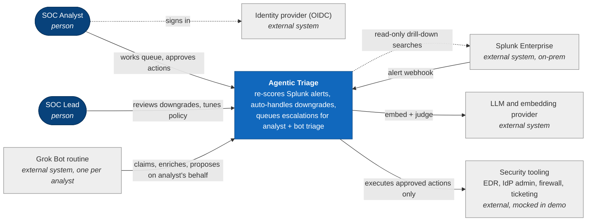

# 01 System context

**Caption.** C4 level 1: the system as one box, with the people and external systems it talks to.
There are no internal parts here (those are in [02](02-containers-deployment.md)). Each arrow crosses
a system boundary and is covered by an external contract: Splunk → system is `ingestSplunkAlert` with
`SplunkWebhookPayload` (schema validation + Schemathesis); analyst → system is the console's use of the
analyst operations (Pact consumer tests + Prism mock); Grok Bot → system is the `/v1/bot/*` operations via
the MCP adapter (Schemathesis + MCP tool tests against a Prism mock); system → LLM is the `LLMClient`
Protocol (Protocol mock in CI, nightly drift run). Tooling connectors have no contract yet; they are mocked
(see [contracts-map.md](contracts-map.md), open items).
