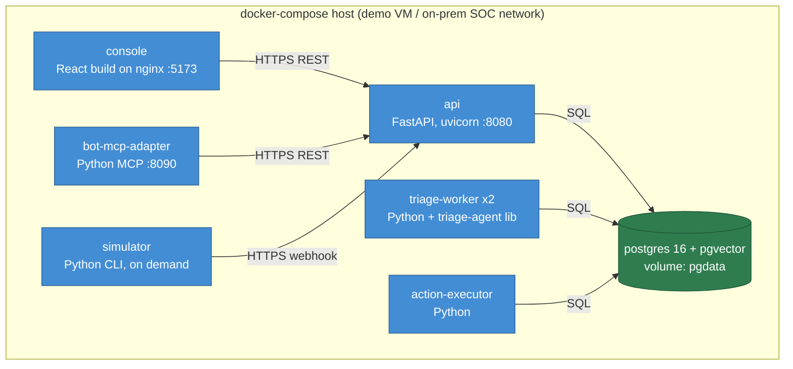

# 02 Containers and deployment

**Caption.** C4 level 2 combined with the deployment view: only runnable processes and the one
datastore, as they run under docker-compose. External systems are left out on purpose (see
[01](01-system-context.md)). Only the API, worker and executor touch Postgres; the console, MCP adapter
and simulator are pure API clients, so they can be tested against a Prism mock of `contracts/openapi.yaml`.
Process ↔ Postgres boundaries are covered by the JSON Schemas (`Alert`, `TriageDecision`, `Case`,
`EvidencePack`, `NextStepsPack`, `ProposedAction`, `AuditEvent`) through DB round-trip tests. The worker
scales horizontally because outbox and queue claims use `FOR UPDATE SKIP LOCKED` (ADR-0003).

| Process | Image | Scale | Health / notes |
|---|---|---|---|
| api | `./services/api` | 1+ (stateless) | `GET /v1/healthz` (`healthz`) |
| triage-worker | `./services/worker` | 2 | SKIP LOCKED makes N workers safe |
| action-executor | `./services/executor` | 1 | runs `approved` actions only; `EXECUTOR_DRY_RUN=true` by default |
| bot-mcp-adapter | `./services/mcp` | 1 | only reaches `/v1/bot/*`; exposed to Grok Bot via a tunnel |
| console | `./apps/console` | 1 | static nginx |
| simulator | `./tools/simulator` | on demand | `make demo` |
| postgres | `pgvector/pgvector:pg16` | 1 | app role has no UPDATE/DELETE on `audit_events` |

**Production sketch.** The same containers on Kubernetes or VMs inside the SOC network next to Splunk;
managed Postgres with point-in-time recovery; optionally a self-hosted LLM so alert data stays on-prem; the
MCP adapter behind an authenticated reverse proxy (mTLS) for Grok Bot; secrets in Vault; OpenTelemetry into
the existing stack.
