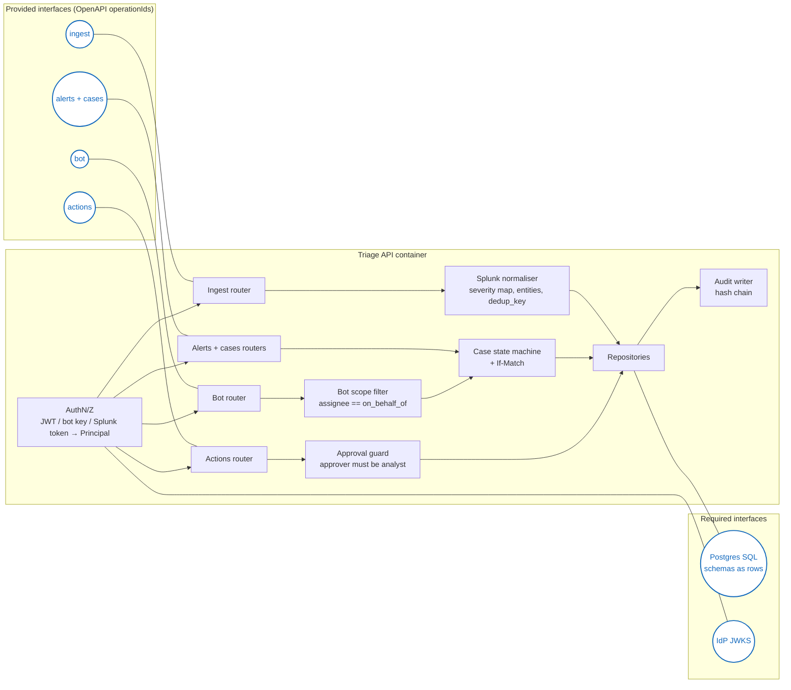

# 03 Components: Triage API

**Caption.** Internal components of the API, with provided interfaces on the left and required ones on
the right. The provided interfaces are the OpenAPI tags: **ingest** = `ingestSplunkAlert`; **alerts + cases** =
`getAlert`, `getTriageDecision`, `listCases`, `getCase`, `getEvidencePack`, `getNextStepsPack`,
`getCaseAudit`, `claimNext`, `releaseCase`, `assignCase`, `transitionCase`; **actions** = `listActions`,
`proposeAction`, `approveAction`, `rejectAction`; **bot** = `botStartRun`, `botFinishRun`, `botListQueue`,
`botClaim`, `botAddEnrichment`, `botPropose`. Schemathesis tests every provided operation against
`openapi.yaml`, and Pact verifies the console's expectations. Two invariants live in named components so they
can be unit-tested on their own: the **Approval guard** (bot principal → 403 + `auth.denied`, checked by the
contract-gate lint and by an invalid `ProposedAction` example) and the **Bot scope filter**. The required SQL
interface is tested by round-tripping every schema example through the repositories.
