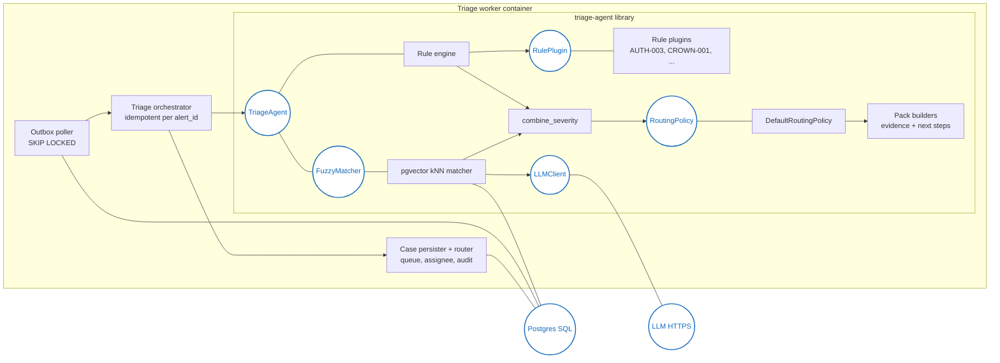

# 04 Components: Triage worker and triage-agent library

**Caption.** The worker takes alerts from the outbox and calls the triage-agent library through the
`TriageAgent` Protocol. Inside the library, the circles are the Python Protocols in
`contracts/agent/interfaces.py`: `RulePlugin`, `FuzzyMatcher`, `LLMClient`, `RoutingPolicy`. Every AI-facing
seam is a Protocol, so CI swaps in `MockFuzzyMatcher` / `MockLLMClient` and runs the golden-alert suite
deterministically. The library's output must validate against `TriageDecision`, `EvidencePack` and
`NextStepsPack` (producer schema validation). `combine_severity` and `DefaultRoutingPolicy` are checked by the
contract gate against the ADR-0005 table and the example decisions. Required interfaces: Postgres
(`triage_outbox`, cases, pgvector corpus) and the LLM provider over HTTPS.
