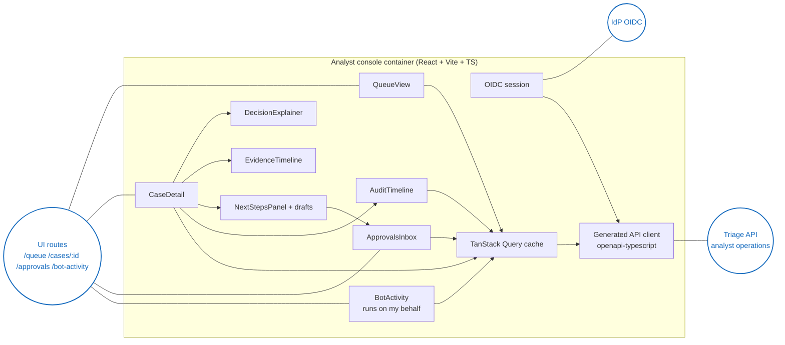

# 05 Components: Analyst console

**Caption.** The console's pages and widgets. They all reach the API through one client generated from
`contracts/openapi.yaml`, so any contract drift becomes a TypeScript compile error. Required operations:
`listCases`, `getCase`, `getTriageDecision`, `getEvidencePack`, `getNextStepsPack`, `getCaseAudit`,
`claimNext`, `releaseCase`, `assignCase`, `transitionCase`, `listActions`, `proposeAction`,
`approveAction`, `rejectAction`, `listBotRuns` (bot activity view, closed gap 2). Verified consumer-side with Pact (consumer-driven contract) and developed
against a Prism mock server that serves `contracts/examples`. Approve/reject are only sent with the analyst's
OIDC token (`analystAuth`).
