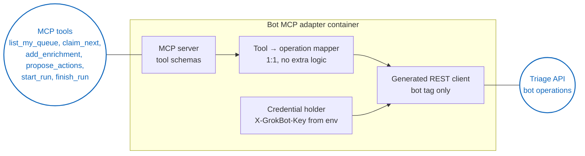

# 06 Components: Bot MCP adapter

**Caption.** A deliberately thin adapter that lets a Grok Bot routine use the bot API as MCP tools.
Each tool maps 1:1 to an OpenAPI operation: `list_my_queue` → `botListQueue`, `claim_next` → `botClaim`,
`add_enrichment` → `botAddEnrichment`, `propose_actions` → `botPropose`, `start_run` → `botStartRun`,
`finish_run` → `botFinishRun`. There is **no approve tool**, and the API would return 403 anyway. Tests:
MCP tool-schema tests plus the adapter running against a Prism mock (consumer-side), and Schemathesis with a
bot key on the provider side. Open item: a bot-readable case bundle (evidence + next steps) is not in the bot
tag yet. See [contracts-map.md](contracts-map.md).
