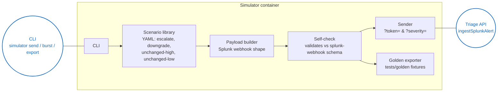

# 07 Components: Splunk alert simulator

**Caption.** Stands in for on-prem Splunk in the demo and in tests. It builds payloads with the same body
shape as Splunk's Webhook alert action, checks each against `SplunkWebhookPayload`
(`contracts/schemas/splunk-webhook.schema.json`) before sending, and calls `ingestSplunkAlert` with the
per-instance token and the severity URL parameter (confirmed input method, ADR-0005). The same builder exports
the golden-alert fixtures, so the agent's golden tests and the live demo use identical inputs.
