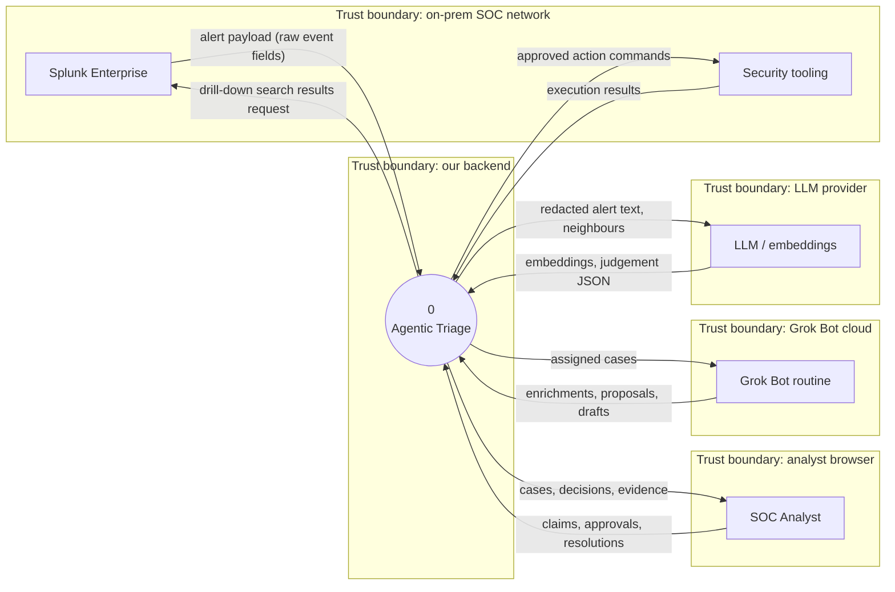

# 08 Data flow diagram, level 0

**Caption.** DFD level 0: the whole system is one process (0), with every data flow that crosses a trust
boundary. These are the five places to apply authentication, validation and redaction. Splunk → 0 uses a
per-instance token and is validated against `SplunkWebhookPayload`. Browser ↔ 0 uses `analystAuth` (OIDC JWT),
covered by Schemathesis + Pact. Grok Bot ↔ 0 uses `botApiKey`, scoped to one analyst, covered by Schemathesis
with a bot key and the bot-scope negative tests. 0 → LLM sends only redacted text through the `LLMClient`
Protocol (mocked in CI). 0 → tooling carries only `approved` `ProposedAction`s.
