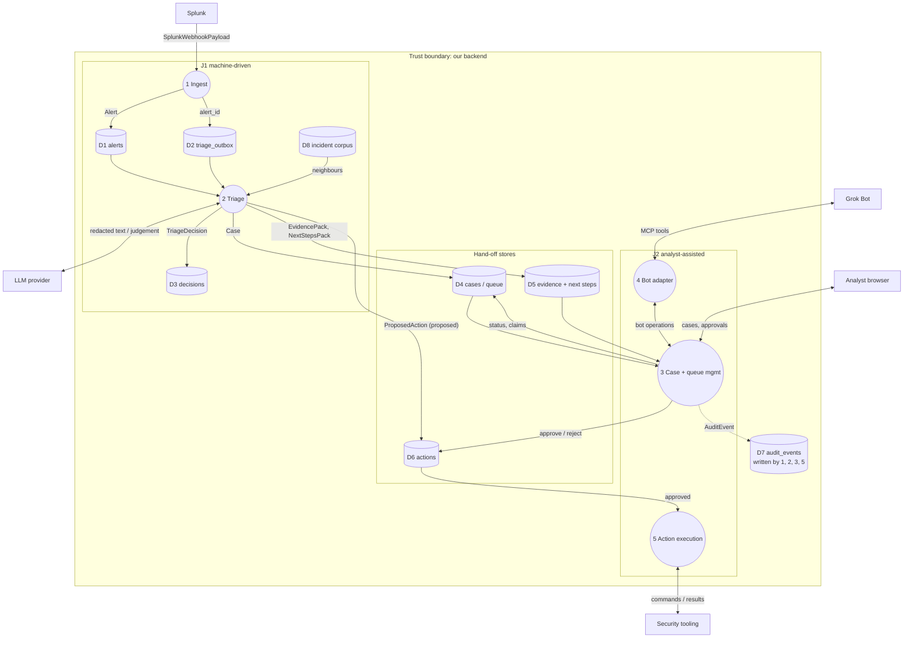

# 09 Data flow diagram, level 1

**Caption.** DFD level 1 inside our backend trust boundary: five processes, eight data stores, and each
flow labelled with the JSON Schema it carries. The external entities sit in their own trust boundaries
exactly as in [level 0](08-dfd-level-0.md) (on-prem Splunk and tooling, analyst browser, Grok Bot cloud,
LLM provider); they are left unboxed here so the diagram fits one slide. It shows where data lands (D1-D8) and which process writes it. Process 2
(triage) is the only one that talks to the LLM provider, and process 5 is the only one that talks to security
tooling. Every process writes `AuditEvent`s to D7 (append-only, hash-chained; chain-verifier test). The
J1/J2 split is drawn explicitly: processes 1-2 are journey J1 (machine-driven), processes 3-5 are journey J2
(analyst-assisted), and they share only the hand-off stores D4-D6, i.e. the `Case`, `EvidencePack`,
`NextStepsPack` and `ProposedAction` contracts.
