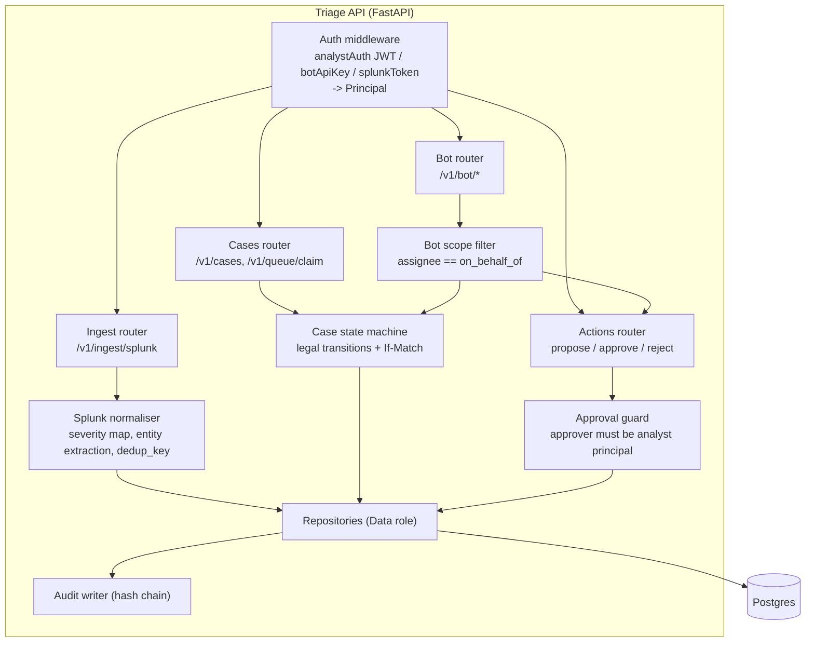
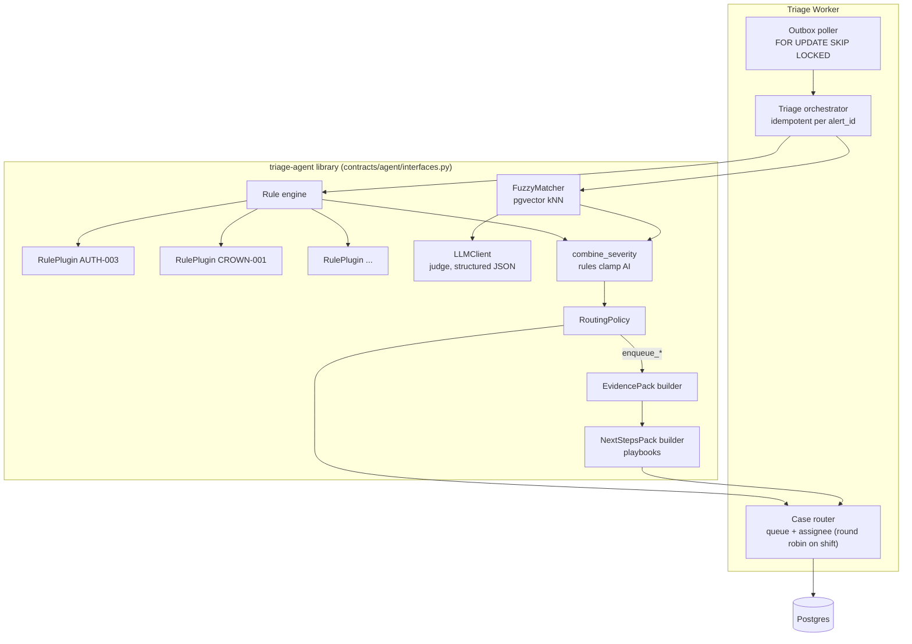
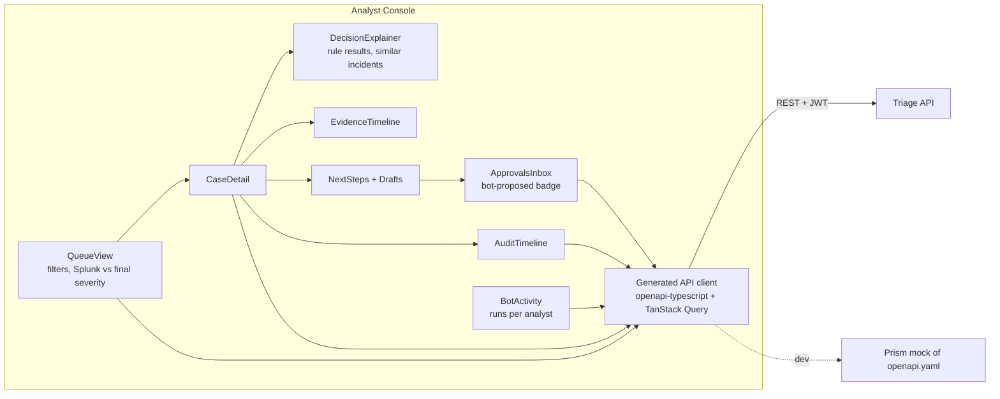
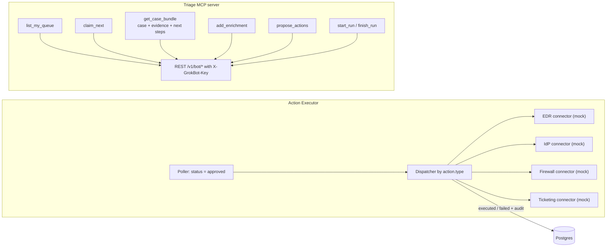

# Component architecture (C4 level 3)

## Triage API (FastAPI)

## Triage Worker + triage-agent library

## Analyst Console (React + Vite + TS)

## Action Executor and Triage MCP server

Note the MCP server deliberately exposes **no approve tool**. Even if it did, the API would refuse it (403).
