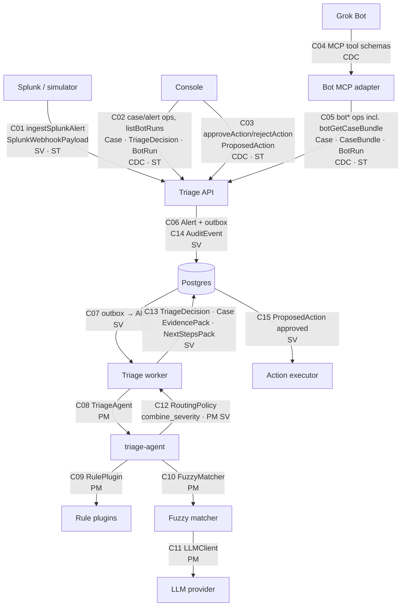

# 10 Interface / contract map

Every boundary between components, labelled with the exact contract and the test type that verifies it.
Test-type keys: **SV** = JSON Schema validation (`scripts/validate_contracts.py` + producer-side checks),
**ST** = Schemathesis against `contracts/openapi.yaml`, **CDC** = consumer-driven contract / mock server
(Pact, Prism), **PM** = Python Protocol mock (`contracts/agent/interfaces.py` mocks + golden alerts).

**Caption.** One arrow per boundary, labelled `Cnn · contract · test types`. The table below is the
authoritative version with full operationId lists. The rule of thumb the diagram encodes: HTTP boundaries
are tested with Schemathesis (provider) plus CDC (consumer), in-process AI boundaries with Protocol mocks, and
persistence boundaries with schema validation of what is written and read back.

## Contract table

| ID | From → To | Contract (exact) | Verified by | Owner (provider) |
|---|---|---|---|---|
| C01 | Splunk / simulator → API | `ingestSplunkAlert`; `splunk-webhook.schema.json` (SplunkWebhookPayload); security `splunkToken`; `?severity=` 1-6 | SV (examples + simulator self-check), ST, golden alerts | Backend |
| C02 | Console → API | `listCases`, `getCase`, `listBotRuns`, `getAlert`, `getTriageDecision`, `getEvidencePack`, `getNextStepsPack`, `getCaseAudit`, `claimNext`, `releaseCase`, `assignCase`, `transitionCase`, `listActions`, `proposeAction`; schemas `Case`, `Alert`, `TriageDecision`, `EvidencePack`, `NextStepsPack`, `AuditEvent`, `ProposedAction` | CDC (Pact consumer + Prism mock), ST (provider) | Backend |
| C03 | Console → API | `approveAction`, `rejectAction` (security `analystAuth` only); `ProposedAction` with `decided_by.type = analyst` | CDC, ST, SV (lint + `invalid/action.bot-approved.json`), negative test bot → 403 | Backend |
| C04 | Grok Bot → MCP adapter | MCP tools `list_my_queue`, `claim_next`, `add_enrichment`, `propose_actions`, `start_run`, `finish_run` (JSON Schemas derived from the bot operations) | CDC (tool-schema tests, adapter vs Prism mock) | Triage-Agent/ML |
| C05 | MCP adapter → API | `botStartRun`, `botFinishRun`, `botListQueue`, `botClaim`, `botGetCaseBundle`, `botAddEnrichment`, `botPropose` (security `botApiKey` only); schemas `Case`, `CaseBundle`, `EvidencePack`, `NextStepsPack`, `BotRun` | ST with bot key, CDC, bot-scope negative tests | Backend |
| C06 | API → Postgres | `alert.schema.json` (Alert) row + `triage_outbox` row in one transaction | SV (DB round-trip of examples) | Data/DB |
| C07 | Postgres → worker | outbox claim (SKIP LOCKED) yielding `Alert` | SV, concurrency test | Data/DB |
| C08 | Worker → agent | `TriageAgent` Protocol: `triage`, `build_evidence_pack`, `build_next_steps` | PM (golden alerts with mocks) | Triage-Agent/ML |
| C09 | Agent → rules | `RulePlugin` Protocol → `RuleResult` (`triage-decision.schema.json#/$defs/RuleResult`) | PM, unit (pure functions) | Triage-Agent/ML |
| C10 | Agent → fuzzy matcher | `FuzzyMatcher` Protocol → `FuzzyMatchResult` (`$defs/FuzzyMatchResult`) | PM (`MockFuzzyMatcher`), SV | Triage-Agent/ML |
| C11 | Fuzzy matcher → LLM | `LLMClient.complete_json` (structured JSON) | PM (`MockLLMClient`); nightly real-model drift run | Triage-Agent/ML |
| C12 | Agent → worker (decision) | `RoutingPolicy` / `DefaultRoutingPolicy`, `combine_severity` (ADR-0005) | PM + SV (contract gate replays the table and example decisions) | Triage-Agent/ML |
| C13 | Worker → Postgres | `TriageDecision`, `Case`, `EvidencePack`, `NextStepsPack`, `ProposedAction` schemas. **This is the J1 → J2 hand-off.** | SV (producer-side validation + DB round-trip) | Backend / Data |
| C14 | API, worker, executor → Postgres | `audit-event.schema.json` (AuditEvent), hash chain | SV, chain-verifier test | Data/DB |
| C15 | Postgres → executor | `ProposedAction` with `status = approved` only | SV, unit (executor ignores non-approved) | Backend |

## Contract gaps

| # | Gap | Status |
|---|---|---|
| 1 | **Bot-readable case bundle.** The bot had no way to read `EvidencePack`/`NextStepsPack`. | **Closed** by PR #33: `botGetCaseBundle` (`GET /v1/bot/cases/{case_id}/bundle`, bot-key only, read-only, scoped to the bot's analyst) returns `CaseBundle` (`case-bundle.schema.json`). Backs the MCP `get_case_bundle` tool. |
| 2 | **Bot activity for the console.** No analyst-facing list of `BotRun`s. | **Closed** by PR #33: `listBotRuns` (`GET /v1/bot-runs`, analyst-only, filters `on_behalf_of`/`bot_id`/`case_id`/`status`/time, paginated) returns `BotRunPage` of `BotRun` (`bot-run.schema.json`). |
| 3 | **Executor → tooling connectors** have no contract. | Open, deliberately out of scope for the demo (connectors are mocked). Proposal: a `Connector` Protocol with mocks. |

The contract gate (`scripts/validate_contracts.py`) now also enforces an explicit auth policy per operation:
bot-only operations declare `botApiKey` and live under `/v1/bot/`, analyst-only operations (`approveAction`,
`rejectAction`, `listBotRuns`) declare `analystAuth`, bot read-only operations are GET, and no bot-auth
operation can approve, reject or execute.
