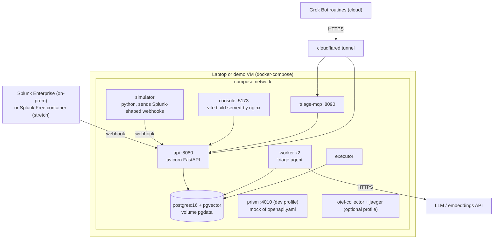

# Deployment view

## Local / demo (docker-compose)

| Service | Image | Scale | Notes |
|---|---|---|---|
| postgres | `pgvector/pgvector:pg16` | 1 | volume `pgdata`; app role has no UPDATE/DELETE on `audit_events` |
| api | `./services/api` | 1 (stateless, can scale) | `/v1/healthz`; config via env |
| worker | `./services/worker` | 2 | SKIP LOCKED makes N workers safe |
| executor | `./services/executor` | 1 | connectors mocked; `EXECUTOR_DRY_RUN=true` default |
| triage-mcp | `./services/mcp` | 1 | only `/v1/bot/*` reachable through it |
| console | `./apps/console` | 1 | nginx static |
| simulator | `./tools/simulator` | on demand | `make demo` |

## Production sketch (on-prem friendly)

Same containers on Kubernetes or VMs inside the SOC network next to Splunk; managed Postgres with
PITR; the LLM endpoint can be a self-hosted model to keep alert data on-prem; Grok Bot reaches the MCP
server through an authenticated reverse proxy with mTLS; secrets in Vault; OpenTelemetry to the existing
observability stack. Splunk HEC can receive our audit events back so the SIEM keeps the record of truth.
