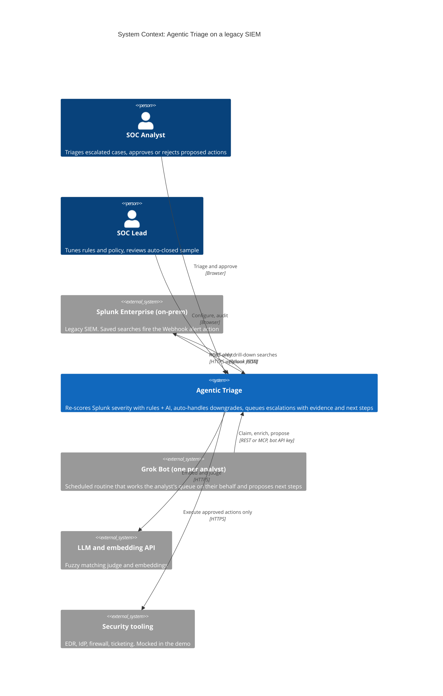
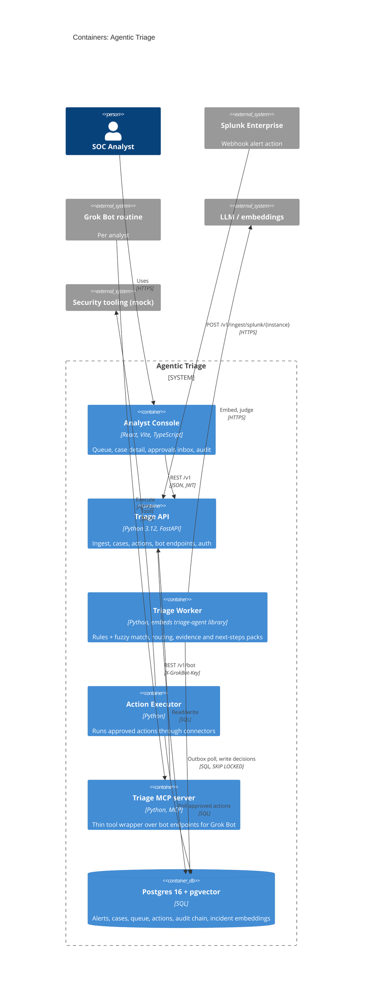
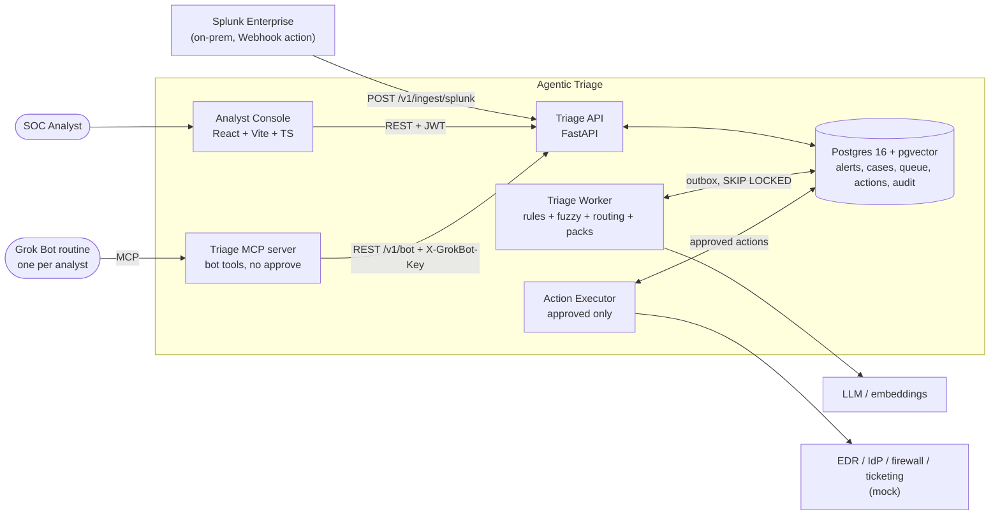

# System architecture: C4 level 1 (context) and level 2 (containers)

## Level 1: System context

## Level 2: Containers

### Same containers, presentation layout (flowchart)

Mermaid's C4 renderer lays out edges loosely; this flowchart is the one to put on a slide.

### Container responsibilities

| Container | Responsibility | Contract it implements |
|---|---|---|
| Analyst Console | Human UI; only place approvals happen | consumes `openapi.yaml` |
| Triage API | AuthN/Z, validation, state machine, audit emission | `openapi.yaml`, all schemas |
| Triage Worker | Async triage of each alert (outbox pattern) | `contracts/agent/interfaces.py`, `triage-decision`, packs |
| Action Executor | Executes `approved` actions only, records result | `action.schema.json` |
| Triage MCP server | Lets a Grok Bot use the bot API as tools | `openapi.yaml#tag/bot` |
| Postgres + pgvector | Durable state, queue, audit chain, vector index | ER diagram |

### Key quality attributes

* **Never lose an alert:** ingest writes alert + outbox row in one transaction, returns 202, idempotent on `sid`.
* **Explainability:** every decision stores all rule results and the similar items used.
* **Safety:** nothing external happens without an analyst approval; downgrades are auditable and re-openable.
* **Swappable AI:** fuzzy matcher and LLM sit behind Protocols; CI runs on mocks only.
