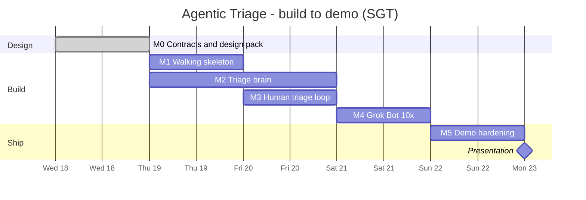
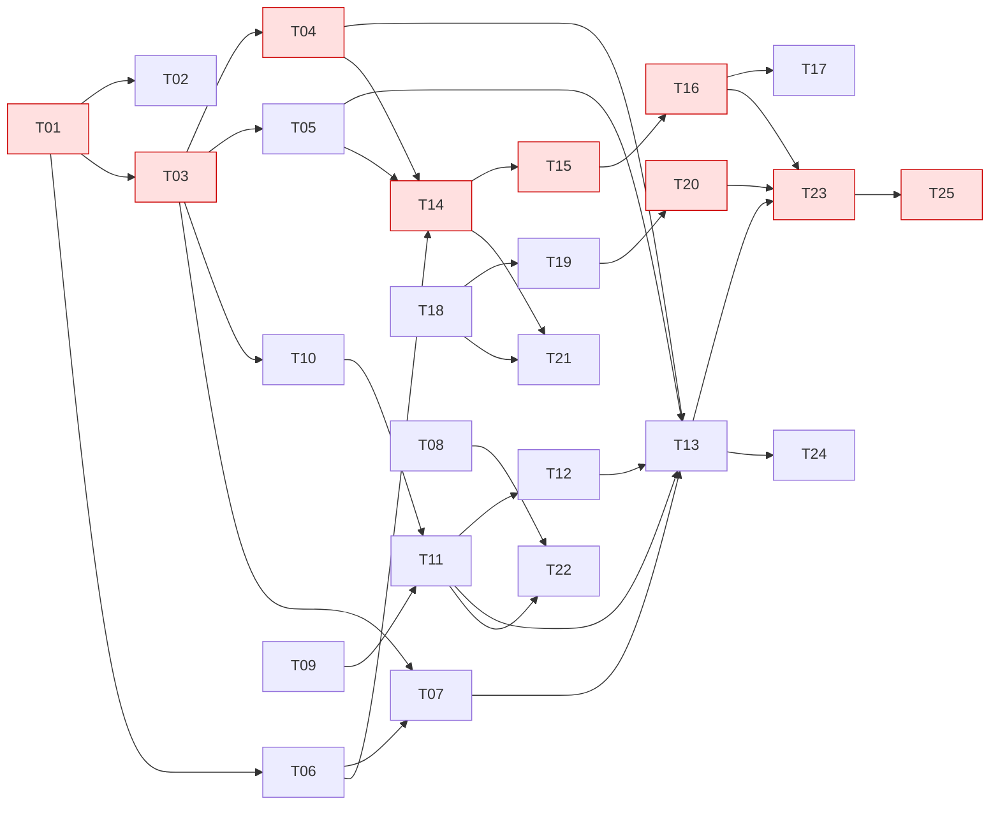

# Delivery plan

Owner: Architect/Tech Lead. Source of truth for tickets is [`plan/tickets.yaml`](../plan/tickets.yaml);
`python scripts/gen_issues.py` regenerates [`plan/issues.json`](../plan/issues.json) (ready for `gh issue create`)
and the ticket section below. CI fails if they drift.

Timeline: design pack today (Wed 18 Nov 2026), demo Mon 23 Nov 2026.

## Milestones

| Milestone | Exit criterion (demoable) |
|---|---|
| M0 Contracts & design | This repo: schemas, OpenAPI, agent interface, diagrams, ADRs; `validate_contracts.py` green |
| M1 Walking skeleton | `make up`; simulator alert -> 202 -> row in `alerts`; console renders cases from Prism mock |
| M2 Triage brain | Golden alerts produce the expected TriageDecision with mocks; real matcher behind a flag |
| M3 Human triage loop | Escalation shows in console queue; analyst claims, approves an action, resolves; downgrade auto-closes with audit |
| M4 Grok Bot 10x | Analyst's Grok Bot routine claims, enriches, proposes; analyst approves from approvals inbox |
| M5 Demo hardening | E2E green 5x, metrics strip, runbook, rendered diagrams in deck |

## Parallelism and the critical path

Because every interface is fixed in M0, the frontend (T18-T20) builds against a Prism mock of the
OpenAPI spec, the agent (T09-T12) builds against fixtures and mocks, and the backend (T06-T16) builds
against the schemas, all at the same time. Integration happens at T13 (worker) and T21/T23 (tests).

Critical path (red): T01 → T03 → T04 → T14 → T15 → T16 → T23 → T25 (with T20 joining at T23).

## How tickets get implemented

1. The Architect turns each ticket into a GitHub issue (from `plan/issues.json`) and a Cursor agent task.
   Each task's prompt names the contract files it must satisfy and the tests that prove it.
2. The role owner (human or coding agent) opens a PR on a branch `t<NN>-<slug>`; CODEOWNERS adds the
   owners of any contract it consumes as reviewers.
3. CI must be green: contract gate, unit, contract tests (Schemathesis/Pact), golden alerts.
4. A contract change is its own PR first (schema + example + ADR note), approved by the Architect and
   every consumer role, then implementations follow.

## Tickets

<!-- TICKETS:START (generated by scripts/gen_issues.py) -->

| ID | Title | Owner | Milestone | Depends on | Contract |
|---|---|---|---|---|---|
| T01 | Repo scaffolding and docker-compose stack | DevOps | M1 | - | `docs/architecture/deployment.md` |
| T02 | CI pipeline (contracts gate, lint, unit, contract tests) | DevOps | M1 | T01 | `docs/testing.md#ci` |
| T03 | Postgres schema and migrations per ER diagram | Data/DB engineer | M1 | T01 | `docs/uml/er-diagram.md` |
| T04 | Queue repository with SKIP LOCKED claims and leases | Data/DB engineer | M1 | T03 | `contracts/openapi.yaml#claimNext, #botClaim` |
| T05 | Hash-chained audit log writer and verifier | Data/DB engineer | M1 | T03 | `contracts/schemas/audit-event.schema.json` |
| T06 | FastAPI skeleton from OpenAPI with three auth schemes | Backend engineer | M1 | T01 | `contracts/openapi.yaml#components/securitySchemes` |
| T07 | Splunk webhook ingest, normalisation and dedup | Backend engineer | M1 | T03, T06 | `contracts/schemas/splunk-webhook.schema.json -> contracts/schemas/alert.schema.json` |
| T08 | Splunk alert simulator and scenario library | QA/contract-test engineer | M1 | - | `contracts/schemas/splunk-webhook.schema.json` |
| T09 | Rule engine, plugin loader and starter rules | Triage-Agent/ML engineer | M2 | - | `contracts/agent/interfaces.py#RulePlugin` |
| T10 | Fuzzy matcher (pgvector kNN + LLM judge) with mock | Triage-Agent/ML engineer | M2 | T03 | `contracts/agent/interfaces.py#FuzzyMatcher, #LLMClient` |
| T11 | Severity combination, routing policy, TriageDecision | Triage-Agent/ML engineer | M2 | T09, T10 | `contracts/schemas/triage-decision.schema.json (ADR-0005)` |
| T12 | Evidence Pack and Next Steps Pack builders | Triage-Agent/ML engineer | M2 | T11 | `contracts/schemas/evidence-pack.schema.json, contracts/schemas/next-steps-pack.schema.json` |
| T13 | Triage worker (outbox -> agent -> case + routing) | Backend engineer | M3 | T04, T05, T07, T11, T12 | `contracts/schemas/case.schema.json` |
| T14 | Case API with state-machine enforcement | Backend engineer | M3 | T04, T05, T06 | `contracts/openapi.yaml#tag/cases, docs/uml/state-machine.md` |
| T15 | Actions API (propose/approve/reject) and mock executor | Backend engineer | M3 | T14 | `contracts/schemas/action.schema.json, contracts/openapi.yaml#tag/actions` |
| T16 | Grok Bot API (keys, runs, queue, claim, enrichments, proposals) | Backend engineer | M4 | T14, T15 | `contracts/openapi.yaml#tag/bot` |
| T17 | Grok Bot routine and triage tool wrapper (MCP + REST) | Triage-Agent/ML engineer | M4 | T16 | `contracts/openapi.yaml#tag/bot, docs/uml/seq-grokbot-routine.md` |
| T18 | Typed API client and mock server for frontend | Frontend engineer | M1 | - | `contracts/openapi.yaml` |
| T19 | Console: queue and case detail | Frontend engineer | M3 | T18 | `contracts/openapi.yaml#tag/cases` |
| T20 | Console: approvals inbox, audit timeline, bot activity | Frontend engineer | M4 | T19 | `contracts/openapi.yaml#tag/actions` |
| T21 | Contract tests (Schemathesis + Pact consumer) | QA/contract-test engineer | M3 | T14, T18 | `contracts/openapi.yaml` |
| T22 | Golden-alert regression suite for the triage agent | QA/contract-test engineer | M2 | T08, T11 | `contracts/schemas/triage-decision.schema.json` |
| T23 | End-to-end demo test | QA/contract-test engineer | M5 | T13, T16, T20 | `docs/uml/user-journeys.md` |
| T24 | Observability and demo metrics | DevOps | M5 | T13 | `docs/architecture/deployment.md` |
| T25 | Demo runbook, seed data and presentation diagrams | Architect/Tech Lead | M5 | T23 | `docs/` |

### T01 - Repo scaffolding and docker-compose stack
*Owner:* DevOps · *Milestone:* M1 Walking skeleton · *Depends on:* none · *Contract:* `docs/architecture/deployment.md`

- [ ] `make up` starts postgres(+pgvector), api, worker, console, simulator; `make down` cleans up
- [ ] Health checks wired; `GET /v1/healthz` reachable on :8080
- [ ] .env.example documents every secret; no secrets committed

### T02 - CI pipeline (contracts gate, lint, unit, contract tests)
*Owner:* DevOps · *Milestone:* M1 Walking skeleton · *Depends on:* T01 · *Contract:* `docs/testing.md#ci`

- [ ] GitHub Actions runs `scripts/validate_contracts.py` on every PR and blocks merge on failure
- [ ] Python (ruff, mypy, pytest) and TS (eslint, tsc, vitest) jobs run in parallel
- [ ] Changes under contracts/ require Architect review (CODEOWNERS)

### T03 - Postgres schema and migrations per ER diagram
*Owner:* Data/DB engineer · *Milestone:* M1 Walking skeleton · *Depends on:* T01 · *Contract:* `docs/uml/er-diagram.md`

- [ ] Alembic migrations create every table in the ER diagram, incl. pgvector extension
- [ ] Round-trip test proves each JSON Schema example can be persisted and re-read identically
- [ ] audit_events is append-only (UPDATE/DELETE revoked from the app role)

### T04 - Queue repository with SKIP LOCKED claims and leases
*Owner:* Data/DB engineer · *Milestone:* M1 Walking skeleton · *Depends on:* T03 · *Contract:* `contracts/openapi.yaml#claimNext, #botClaim`

- [ ] Claim uses `SELECT ... FOR UPDATE SKIP LOCKED` ordered by priority desc, created_at asc
- [ ] 50 concurrent claimers never double-claim (property test)
- [ ] Expired leases return cases to `queued` and emit `case.lease_expired`
- [ ] Bot claims are filtered to cases assigned to the bot's analyst

### T05 - Hash-chained audit log writer and verifier
*Owner:* Data/DB engineer · *Milestone:* M1 Walking skeleton · *Depends on:* T03 · *Contract:* `contracts/schemas/audit-event.schema.json`

- [ ] Every write path emits an AuditEvent in the same transaction as the state change
- [ ] `verify_chain()` detects a tampered row in a test
- [ ] Emitted events validate against audit-event.schema.json

### T06 - FastAPI skeleton from OpenAPI with three auth schemes
*Owner:* Backend engineer · *Milestone:* M1 Walking skeleton · *Depends on:* T01 · *Contract:* `contracts/openapi.yaml#components/securitySchemes`

- [ ] All operations from openapi.yaml exist (501 stubs allowed) and FastAPI's generated spec diffs clean against the contract
- [ ] analystAuth (JWT), botApiKey (X-GrokBot-Key -> bot_id + on_behalf_of), splunkToken (query) enforced
- [ ] Errors are RFC 9457 problem+json

### T07 - Splunk webhook ingest, normalisation and dedup
*Owner:* Backend engineer · *Milestone:* M1 Walking skeleton · *Depends on:* T03, T06 · *Contract:* `contracts/schemas/splunk-webhook.schema.json -> contracts/schemas/alert.schema.json`

- [ ] Both splunk-webhook examples ingest with 202 and produce Alerts equal to alert.*.json (ids/timestamps aside)
- [ ] Severity mapping 1-6 -> 5 levels as documented in common.schema.json; ?severity overrides result.severity
- [ ] Idempotent on sid (second POST returns 200 duplicate); alert + outbox row written in one transaction

### T08 - Splunk alert simulator and scenario library
*Owner:* QA/contract-test engineer · *Milestone:* M1 Walking skeleton · *Depends on:* none · *Contract:* `contracts/schemas/splunk-webhook.schema.json`

- [ ] `simulator send <scenario>` posts byte-for-byte Splunk-shaped webhooks to the ingest URL
- [ ] Scenarios: credential stuffing (escalate), EICAR on CI (downgrade), TOR egress (unchanged-high), noisy port scan (unchanged-low), burst mode
- [ ] Every generated payload validates against splunk-webhook.schema.json

### T09 - Rule engine, plugin loader and starter rules
*Owner:* Triage-Agent/ML engineer · *Milestone:* M2 Triage brain · *Depends on:* none · *Contract:* `contracts/agent/interfaces.py#RulePlugin`

- [ ] Rules discovered from a package, run by priority, every result recorded (matched or not)
- [ ] Starter rules: AUTH-003, ALLOW-007, ALLOW-011, CROWN-001 (never_auto_close), PRIV-002 (privileged user +1), TOR-004
- [ ] 100% branch coverage on rules; no I/O in rule code (enforced by test)

### T10 - Fuzzy matcher (pgvector kNN + LLM judge) with mock
*Owner:* Triage-Agent/ML engineer · *Milestone:* M2 Triage brain · *Depends on:* T03 · *Contract:* `contracts/agent/interfaces.py#FuzzyMatcher, #LLMClient`

- [ ] Incident/pattern/baseline corpus seeded (>= 30 items) and embedded into pgvector
- [ ] LLM judge returns structured JSON validated against FuzzyMatchResult $def
- [ ] Timeout -> rules-only fallback with guardrail `fuzzy_timeout_fallback`
- [ ] MockFuzzyMatcher used by all CI tests

### T11 - Severity combination, routing policy, TriageDecision
*Owner:* Triage-Agent/ML engineer · *Milestone:* M2 Triage brain · *Depends on:* T09, T10 · *Contract:* `contracts/schemas/triage-decision.schema.json (ADR-0005)`

- [ ] Implements combine_severity order and DefaultRoutingPolicy table exactly
- [ ] Decisions for golden alerts equal triage-decision.*.json (ids/timestamps aside)
- [ ] Candidate labels created on escalation

### T12 - Evidence Pack and Next Steps Pack builders
*Owner:* Triage-Agent/ML engineer · *Milestone:* M2 Triage brain · *Depends on:* T11 · *Contract:* `contracts/schemas/evidence-pack.schema.json, contracts/schemas/next-steps-pack.schema.json`

- [ ] Packs built for every enqueue_* disposition; every evidence item has provenance
- [ ] Playbooks for 3 scenarios; proposed actions are status=proposed, requires_approval=true
- [ ] Output validates against schemas

### T13 - Triage worker (outbox -> agent -> case + routing)
*Owner:* Backend engineer · *Milestone:* M3 Human triage loop · *Depends on:* T04, T05, T07, T11, T12 · *Contract:* `contracts/schemas/case.schema.json`

- [ ] Every alert yields a case; escalations land in soc-high, low-confidence downgrades in soc-downgrade-review, auto-closes get status auto_closed + audit
- [ ] Worker is idempotent and retry-safe (crash between steps never loses or duplicates a case)
- [ ] Round-robin assignment to on-shift analysts

### T14 - Case API with state-machine enforcement
*Owner:* Backend engineer · *Milestone:* M3 Human triage loop · *Depends on:* T04, T05, T06 · *Contract:* `contracts/openapi.yaml#tag/cases, docs/uml/state-machine.md`

- [ ] list/get/assign/claim/release/transition implemented; illegal transitions 409; stale If-Match 412
- [ ] Responses validate against case.schema.json (Schemathesis green)

### T15 - Actions API (propose/approve/reject) and mock executor
*Owner:* Backend engineer · *Milestone:* M3 Human triage loop · *Depends on:* T14 · *Contract:* `contracts/schemas/action.schema.json, contracts/openapi.yaml#tag/actions`

- [ ] Approve/reject reject bot credentials with 403 and an auth.denied audit event
- [ ] Executor only picks actions with status approved; results recorded; connectors are mocks (EDR/IdP/firewall/ticketing)
- [ ] Case moves to awaiting_approval while any action is proposed

### T16 - Grok Bot API (keys, runs, queue, claim, enrichments, proposals)
*Owner:* Backend engineer · *Milestone:* M4 Grok Bot 10x · *Depends on:* T14, T15 · *Contract:* `contracts/openapi.yaml#tag/bot`

- [ ] Bot key bound to one analyst; cannot read or claim other analysts' cases (403)
- [ ] All bot writes audited with actor.type=grok_bot and on_behalf_of
- [ ] Rate limit per key; keys revocable from the console

### T17 - Grok Bot routine and triage tool wrapper (MCP + REST)
*Owner:* Triage-Agent/ML engineer · *Milestone:* M4 Grok Bot 10x · *Depends on:* T16 · *Contract:* `contracts/openapi.yaml#tag/bot, docs/uml/seq-grokbot-routine.md`

- [ ] Routine prompt + schedule (every 10 min on shift) documented; one routine per analyst
- [ ] Thin MCP server exposing list_my_queue, claim, add_enrichment, propose; falls back to curl/REST
- [ ] Demo shows a bot enriching and proposing on a fresh escalated case end-to-end

### T18 - Typed API client and mock server for frontend
*Owner:* Frontend engineer · *Milestone:* M1 Walking skeleton · *Depends on:* none · *Contract:* `contracts/openapi.yaml`

- [ ] TS types/client generated from openapi.yaml (openapi-typescript) in CI; drift fails the build
- [ ] Prism mock server serves contracts/examples so the console can be built before the backend exists

### T19 - Console: queue and case detail
*Owner:* Frontend engineer · *Milestone:* M3 Human triage loop · *Depends on:* T18 · *Contract:* `contracts/openapi.yaml#tag/cases`

- [ ] Queue view filters by queue/severity/direction; shows Splunk vs final severity and candidate labels
- [ ] Case detail shows decision explanation (rules + similar incidents), evidence timeline, next steps
- [ ] Works against Prism mock and the real API with the same code

### T20 - Console: approvals inbox, audit timeline, bot activity
*Owner:* Frontend engineer · *Milestone:* M4 Grok Bot 10x · *Depends on:* T19 · *Contract:* `contracts/openapi.yaml#tag/actions`

- [ ] Approve/reject with note; bot-proposed items visibly badged "proposed by Grok Bot on your behalf"
- [ ] Audit timeline per case; downgrade-review queue with one-click re-open of auto-closed cases

### T21 - Contract tests (Schemathesis + Pact consumer)
*Owner:* QA/contract-test engineer · *Milestone:* M3 Human triage loop · *Depends on:* T14, T18 · *Contract:* `contracts/openapi.yaml`

- [ ] Schemathesis runs all operations against the live API in CI with zero schema violations
- [ ] Pact consumer tests from the console verified against the provider
- [ ] Negative tests for the human-approval invariant (bot -> approve = 403)

### T22 - Golden-alert regression suite for the triage agent
*Owner:* QA/contract-test engineer · *Milestone:* M2 Triage brain · *Depends on:* T08, T11 · *Contract:* `contracts/schemas/triage-decision.schema.json`

- [ ] >= 12 golden alerts with expected direction/disposition/final severity, run with mocks
- [ ] Report shows escalate/downgrade/unchanged confusion matrix

### T23 - End-to-end demo test
*Owner:* QA/contract-test engineer · *Milestone:* M5 Demo hardening · *Depends on:* T13, T16, T20 · *Contract:* `docs/uml/user-journeys.md`

- [ ] Playwright: simulator burst -> downgrades auto-close -> escalation queued -> bot enriches + proposes -> analyst approves -> executor runs -> case resolved
- [ ] Runs green 5 times in a row in CI

### T24 - Observability and demo metrics
*Owner:* DevOps · *Milestone:* M5 Demo hardening · *Depends on:* T13 · *Contract:* `docs/architecture/deployment.md`

- [ ] Structured JSON logs with alert_id/case_id correlation; OpenTelemetry traces ingest -> decision
- [ ] Console metrics strip: alerts in, % auto-closed, escalations, bot proposals, approval latency

### T25 - Demo runbook, seed data and presentation diagrams
*Owner:* Architect/Tech Lead · *Milestone:* M5 Demo hardening · *Depends on:* T23 · *Contract:* `docs/`

- [ ] One-command demo reset + seed; 7-minute script with fallback recording
- [ ] Rendered diagrams embedded in the slide deck; ADRs up to date

<!-- TICKETS:END -->

## Risks

| Risk | Mitigation |
|---|---|
| Demo can't reach a real Splunk | Simulator emits byte-identical webhook bodies; optional Splunk Free container as a stretch |
| LLM latency / flakiness on stage | Mock matcher toggle; cached embeddings; timeout fallback is itself a demo talking point |
| Grok Bot routine needs to reach a local API | Expose via a tunnel (cloudflared) or deploy to a small VM; MCP wrapper keeps the bot side unchanged |
| Scope creep in 4 build days | M3 is the "must-have" line; M4 is the differentiator; M5 cuts to the runbook if late |
