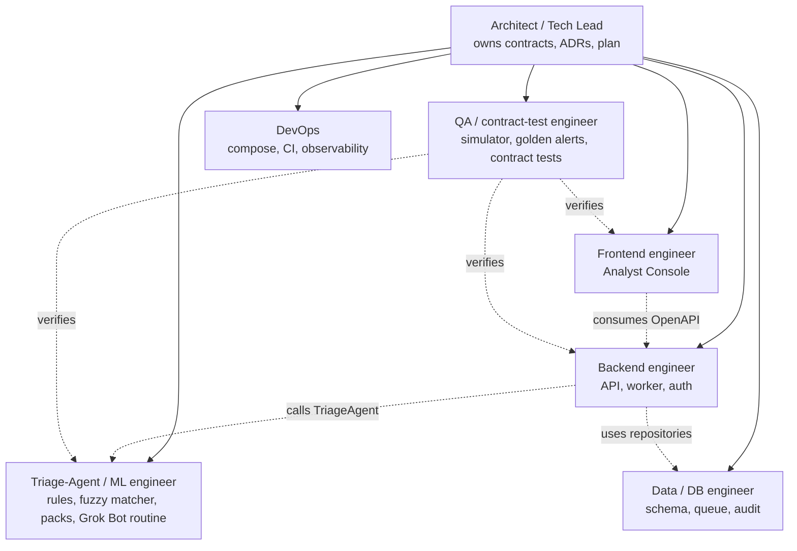

# Team

Seven roles. In this build each role is played by a coding agent (Cursor agents / Grok Bot executors)
directed by the Architect; in a real engagement they map 1:1 to people. Roles are defined by **what
they own** (code + contracts) so two roles never edit the same thing without a review.

## Contract ownership matrix

O = owns (only role that may change it, via PR + ADR note) · C = consumes (must be a reviewer on changes)

| Contract | Arch | Backend | Agent | Frontend | Data | QA | DevOps |
|---|---|---|---|---|---|---|---|
| `contracts/openapi.yaml` | O | O (co-owner) | C (bot tag) | C | | C | |
| `schemas/common.schema.json` | O | C | C | C | C | C | |
| `schemas/splunk-webhook.schema.json` | O | C | | | | C | |
| `schemas/alert.schema.json` | | O | C | C | C | C | |
| `schemas/triage-decision.schema.json` | | C | O | C | C | C | |
| `schemas/evidence-pack.schema.json` | | C | O | C | C | C | |
| `schemas/next-steps-pack.schema.json` | | C | O | C | C | C | |
| `schemas/action.schema.json` | | O | C | C | C | C | |
| `schemas/case.schema.json` | | O | C | C | C | C | |
| `schemas/audit-event.schema.json` | | C | | C | O | C | |
| `contracts/agent/interfaces.py` | C | C | O | | | C | |
| ER diagram / migrations | C | C | C | | O | | |
| State machine (`docs/uml/state-machine.md`) | O | C | | C | C | C | |
| CI workflow, compose, env | C | | | | | C | O |

## Roles

### Architect / Tech Lead
* **Owns:** `contracts/` (final say), `docs/architecture`, `docs/adr`, `docs/uml`, `plan/`. Breaks work into tickets, assigns them, reviews every contract change, runs integration.
* **Consumes:** everything; is the tie-breaker on cross-role disputes.
* **Definition of done:** contracts validate in CI; each ticket names its contract and acceptance criteria; ADR exists for every significant choice; demo runbook rehearsed.

### Backend engineer
* **Owns:** `services/api` (FastAPI app, auth, routers), `services/worker` (outbox consumer that calls the agent and routes), action executor + mock connectors. Co-owns `openapi.yaml`; owns `alert`, `case`, `action` schemas.
* **Consumes:** `triage-decision`, `evidence-pack`, `next-steps-pack` (from Agent), repositories + `audit-event` (from Data), `splunk-webhook` (from Arch).
* **Definition of done:** endpoint matches OpenAPI (Schemathesis green), auth rules enforced incl. the human-approval invariant, every state change emits an AuditEvent, unit coverage ≥ 80 %, no 5xx under Schemathesis fuzzing.

### Triage-Agent / ML engineer
* **Owns:** `services/agent` (library): rule engine + rule plugins, fuzzy matcher (pgvector kNN + LLM judge), `combine_severity`, routing policy, evidence/next-steps builders, playbooks; the Grok Bot routine prompt and the MCP/REST tool wrapper. Owns `triage-decision`, `evidence-pack`, `next-steps-pack` schemas and `contracts/agent/interfaces.py`.
* **Consumes:** `alert` schema, DB access for the vector index (via Data's repository), `openapi.yaml` bot endpoints.
* **Definition of done:** golden alerts pass with mocks; decision output validates; real matcher has timeout + fallback; every decision explainable (all rule results + similar items recorded); prompt/model version recorded in `agent_version`.

### Frontend engineer
* **Owns:** `apps/console` (React + Vite + TS): queue view, case detail, decision explanation, evidence timeline, approvals inbox, audit timeline, bot activity, generated API client.
* **Consumes:** `openapi.yaml` (generates types; builds against a Prism mock until the API is ready), all response schemas.
* **Definition of done:** typecheck clean against generated client; Pact consumer tests published; works unchanged against mock and real API; approve/reject only from the analyst session; accessible (keyboard + contrast).

### Data / DB engineer
* **Owns:** `db/migrations` (Alembic), repositories, the queue (claim/lease/reaper), audit log writer + chain verifier, seed data and the incident corpus tables. Owns `audit-event` schema and the ER diagram.
* **Consumes:** `alert`, `case`, `action`, `triage-decision` schemas (persistence shape).
* **Definition of done:** migrations up/down clean; every schema example round-trips through the DB; concurrency test proves no double claim; audit chain verifies; indexes cover queue + list queries (EXPLAIN in PR).

### QA / contract-test engineer
* **Owns:** `tools/simulator` (Splunk alert simulator), `tests/golden`, `tests/contract` (Schemathesis, Pact verification), `tests/e2e` (Playwright), negative examples in `contracts/examples/invalid`.
* **Consumes:** every contract.
* **Definition of done:** each contract has positive + negative tests; golden suite covers escalate/downgrade/unchanged and guardrails; E2E demo path green 5× in a row; flaky tests quarantined with an issue.

### DevOps
* **Owns:** `docker-compose.yml`, Dockerfiles, `.github/workflows`, `Makefile`, env/secret handling, observability (logs, OTel traces, metrics strip data), tunnel/VM for the Grok Bot to reach the API.
* **Consumes:** service health endpoints, `docs/testing.md` CI outline.
* **Definition of done:** `make up` from a clean clone in < 3 min; CI < 10 min; secrets never in git; one-command demo reset.

## Working agreements

1. **Contract first.** No implementation PR may change a file under `contracts/`. Contract changes go in their own PR with an updated example and (if behavioural) an ADR.
2. **Mocks are first-class.** Every consumer can build against a mock of its provider on day one (Prism for the API, `MockFuzzyMatcher`/`MockLLMClient` for AI, simulator for Splunk).
3. **Small PRs per ticket**, branch `t<NN>-<slug>`, squash-merge to `main`, conventional commits.
4. **Daily integration** at 18:00 SGT: Architect merges, runs E2E, re-plans.
