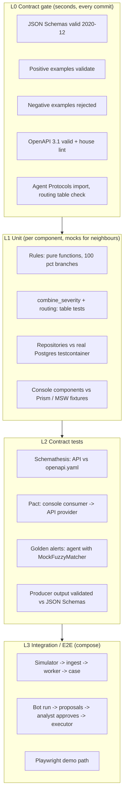
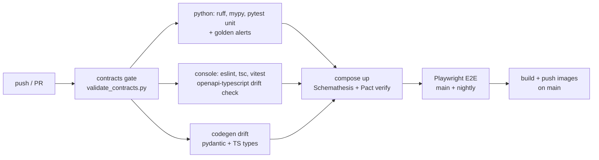

# Testing strategy: contract-first

Owner: QA/contract-test engineer (with every role writing their own unit tests).

The contracts in `contracts/` are fixed first, so every component can be tested **in isolation against
the contract** and integration tests only have to prove wiring.



**Caption.** The four test layers, cheapest first. L0 is the contract gate (schema validation, OpenAPI lint, Protocol checks); L2 holds the contract tests named in [contracts-map.md](architecture/contracts-map.md) (Schemathesis, Pact/Prism, golden alerts with Protocol mocks).

## L0: contract gate (`scripts/validate_contracts.py`)

Runs in < 2 s, blocks every PR. It checks:
1. every schema is valid Draft 2020-12;
2. every `contracts/examples/<schema>[.<Def>].<variant>.json` validates (format checks on, e.g. uuid, date-time);
3. every file in `contracts/examples/invalid/` **fails**. These pin invariants, e.g. `action.bot-approved.json`
   proves a Grok Bot can never be `decided_by`, and `common.Principal.bot-without-analyst.json` proves a bot
   principal must carry `on_behalf_of`;
4. `openapi.yaml` is valid OpenAPI 3.1 with all external `$ref`s resolved, plus house rules: unique
   `operationId`, tags, `/v1` prefix, `approve`/`reject` are `analystAuth`-only, `/v1/bot/*` are `botApiKey`-only,
   plus an explicit per-operation auth policy (bot-only vs analyst-only incl. `listBotRuns`; bot read-only ops
   such as `botGetCaseBundle` must be GET; no bot-auth operation may approve, reject or execute);
5. `contracts/agent/interfaces.py` imports; mocks satisfy the Protocols; `DefaultRoutingPolicy` matches the ADR-0005 table;
6. `plan/issues.json` is in sync with `plan/tickets.yaml`.

## L1: unit tests with mocks

| Component | Mocks it uses | Tooling |
|---|---|---|
| Rule plugins | none (pure) | pytest, hypothesis |
| Fuzzy matcher | `MockLLMClient`, fixed embeddings | pytest |
| API routers | in-memory repositories or testcontainers Postgres | pytest + httpx |
| Queue repository | real Postgres (testcontainers) | pytest, 50-thread claim race test |
| Console | Prism mock / MSW handlers generated from `contracts/examples` | vitest + Testing Library |

**LLM mocking rule:** CI never calls a real model. `MockFuzzyMatcher(fixtures)` returns recorded
`FuzzyMatchResult`s keyed by `search_name`; `MockLLMClient(canned)` returns canned JSON. A nightly
non-blocking job runs the golden suite against the real model and reports drift (decisions that changed).

## L2: contract tests

* **Provider: Schemathesis** against the running API in compose:
  `schemathesis run contracts/openapi.yaml --base-url http://localhost:8080 --checks all -H "Authorization: Bearer $DEV_JWT"`
  (plus a second run with `X-GrokBot-Key` to cover `/v1/bot/*`). Any response not matching the schema, 5xx or
  undocumented status fails. Stateful links exercise ingest → get decision → claim → approve.
* **Consumer: Pact** (pact-js) from the console for the calls it actually makes (list cases, get case
  bundle, approve/reject). Pacts are published as CI artifacts and verified against the FastAPI provider
  (pact-python verifier). This catches "the console relies on a field the API stopped sending" even when
  the OpenAPI is still technically satisfied.
* **Producer schema checks:** every object the agent emits (`TriageDecision`, packs) and every
  `AuditEvent` the DB layer writes is validated against its JSON Schema in tests.
* **Golden alerts** (`tests/golden/NN-name/{webhook.json, fixtures.json, expected.json}`): ≥ 12 cases covering
  escalate, downgrade-auto-close, downgrade-review (low confidence), never_auto_close guard, unchanged-high,
  unchanged-low, fuzzy timeout, duplicate sid, multivalue fields. Expected = direction, disposition,
  final_severity, labels (ids and timestamps ignored). Generated payloads come from the simulator.
* **Security negative tests:** bot key → approve = 403 + `auth.denied` event; bot key for analyst A cannot
  read/claim analyst B's case; wrong Splunk token = 401; stale `If-Match` = 412.

## L3: E2E

`make e2e` brings up compose, runs the simulator burst (10 alerts: 7 noise, 2 escalations, 1 unchanged-high),
drives one bot run with a scripted MCP client, then Playwright logs in as an analyst, approves, and checks the
case is resolved and the audit chain verifies.

## CI outline (GitHub Actions) {#ci}

`.github/workflows/contracts.yml` (exists now) runs the L0 gate. The full pipeline once code lands:



**Caption.** GitHub Actions stages once code lands. The contract gate runs first and blocks everything; codegen drift checks make sure generated Pydantic and TypeScript types still match `contracts/`.

```yaml
# sketch of the full workflow
jobs:
  contracts:   { steps: [checkout, setup-python, pip install -r requirements-dev.txt, python scripts/validate_contracts.py] }
  python:      { needs: contracts, services: { postgres: pgvector/pgvector:pg16 }, steps: [ruff, mypy, pytest -m "not e2e"] }
  console:     { needs: contracts, steps: [npm ci, npm run gen:api && git diff --exit-code, npm run lint, npm run typecheck, npm test] }
  contract-tests: { needs: [python, console], steps: [docker compose up -d --wait, schemathesis run ..., pact verify] }
  e2e:         { needs: contract-tests, if: "github.ref == 'refs/heads/main' || github.event_name == 'schedule'", steps: [make e2e] }
```

CODEOWNERS makes the Architect and the consuming roles required reviewers for anything under `contracts/`.
