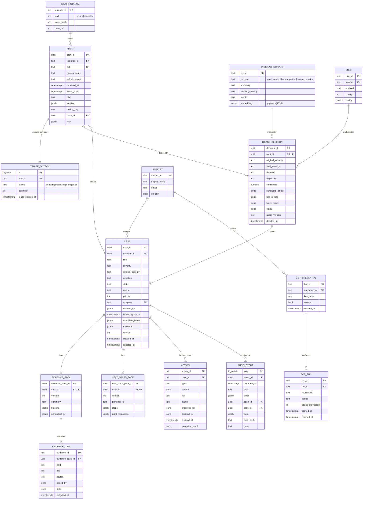

# ER diagram (Postgres)

Owner: Data/DB engineer. JSONB columns hold sub-documents whose shape is fixed by the JSON Schemas.

Key indexes: `cases (queue, status, priority DESC, created_at) WHERE status='queued'`; `cases (assignee, status)`;
`alerts (sid) UNIQUE`; `alerts (dedup_key) WHERE case open`; `triage_outbox (status, id)`; `actions (status) WHERE status='approved'`;
`incident_corpus USING hnsw (embedding vector_cosine_ops)`.

**Caption.** Physical data model in Postgres, owned by the Data/DB engineer. JSONB columns hold sub-documents
whose shape is fixed by the JSON Schemas (`TriageDecision.rule_results`, `Case.claimed_by`, `ProposedAction.params`,
...). The J1 → J2 hand-off is visible here: J1 writes `ALERT`, `TRIAGE_DECISION`, `CASE`, `EVIDENCE_PACK`,
`NEXT_STEPS_PACK` and `ACTION(proposed)`; J2 reads them and writes claims, enrichments, decisions and
`AUDIT_EVENT`s. Verified by DB round-trip tests (every example under `contracts/examples` is inserted and read
back, then validated against its schema), migration up/down tests, and the audit chain verifier.

