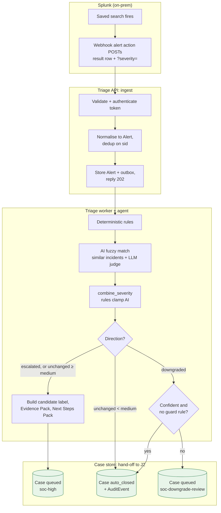

# Journey J1: Alert ingestion and agentic triage (machine-driven, no human)

**Caption.** Journey J1 in swimlanes by actor. No human is involved: Splunk raises an alert, the API takes
it in, the worker re-scores it, and the journey ends in exactly one of three Case outcomes in the case store.
This is the only place J1 touches J2. Contracts on the way: `ingestSplunkAlert` with `SplunkWebhookPayload`
(schema validation, Schemathesis), the `Alert` schema, the agent Protocols `RulePlugin`, `FuzzyMatcher`,
`LLMClient`, `RoutingPolicy` (Protocol mocks, golden alerts), and at the end `TriageDecision`, `Case`,
`EvidencePack`, `NextStepsPack`, `AuditEvent` (producer-side schema validation). Routing follows ADR-0005,
including the confirmed unchanged-severity policy.
