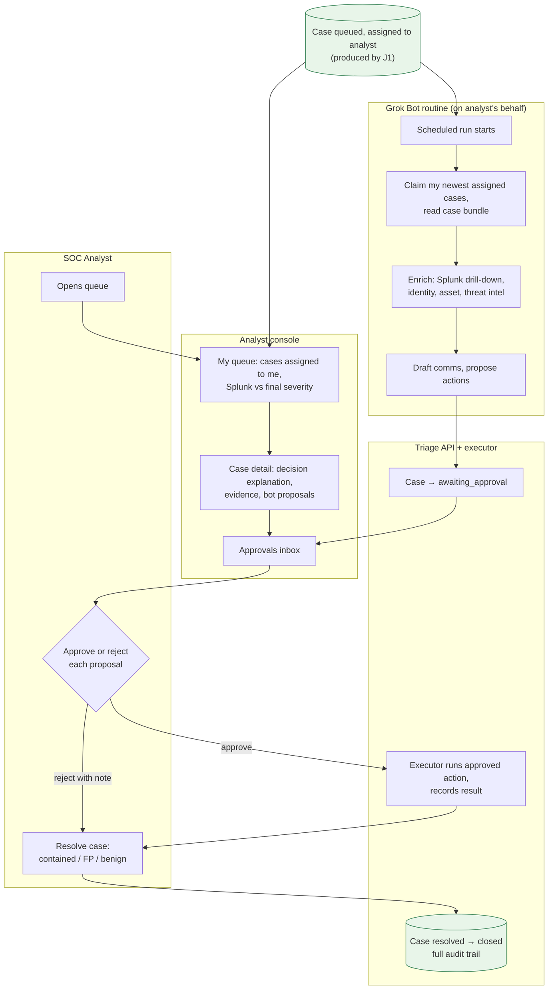

# Journey J2: Analyst-assisted triage (SOC analyst + Grok Bot in the console)

**Caption.** Journey J2 in swimlanes by actor. It starts from a queued Case assigned to the analyst, which
is the only input it takes from J1. The analyst's Grok Bot does the legwork (claim, enrich, propose); the
analyst decides in the console; only analyst-approved actions run. Contracts: bot side `botStartRun`,
`botClaim`, `botGetCaseBundle`, `botAddEnrichment`, `botPropose`, `botFinishRun` behind the MCP adapter (Schemathesis with a bot
key, MCP tool tests vs Prism mock); console side `listCases`, `listBotRuns`, `getCase`, `getTriageDecision`,
`getEvidencePack`, `getNextStepsPack`, `approveAction`, `rejectAction`, `transitionCase` (Pact consumer +
Schemathesis provider); invariant `ProposedAction.decided_by.type = analyst` (schema validation and the
bot → approve = 403 negative test).
