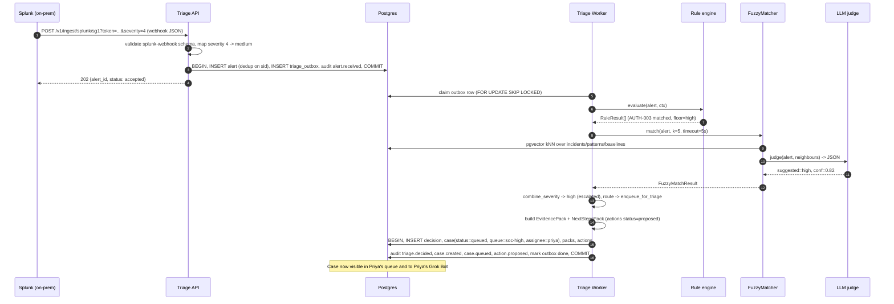

# Sequence: Splunk alert → agent → escalate → human-assisted triage queue

Failure handling: the worker is idempotent on `alert_id` (unique decision per alert). A crash before COMMIT
leaves the outbox row unclaimed after its lease, so it is retried. A fuzzy timeout gives a rules-only
decision with guardrail `fuzzy_timeout_fallback`.
