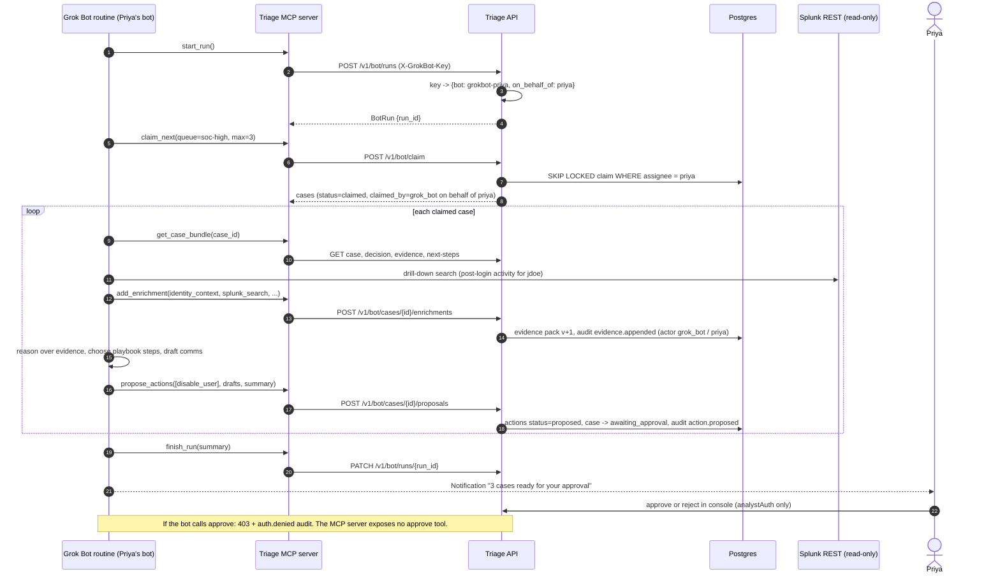
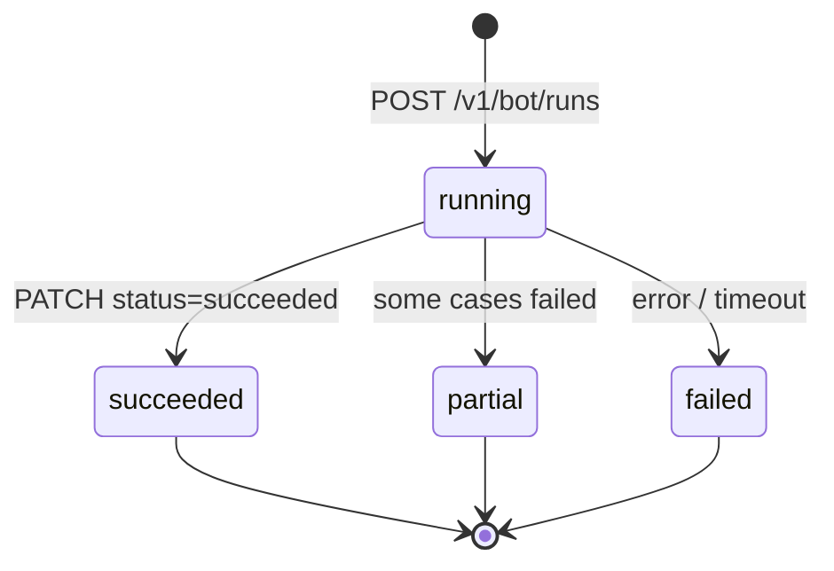

# Sequence: Grok Bot routine works the queue on behalf of an analyst

The routine is configured once per analyst, e.g. *"Every 10 minutes during my shift: claim my newest
triage cases, enrich them, draft comms and propose next steps for my approval. Never approve anything."*

## Bot run states

