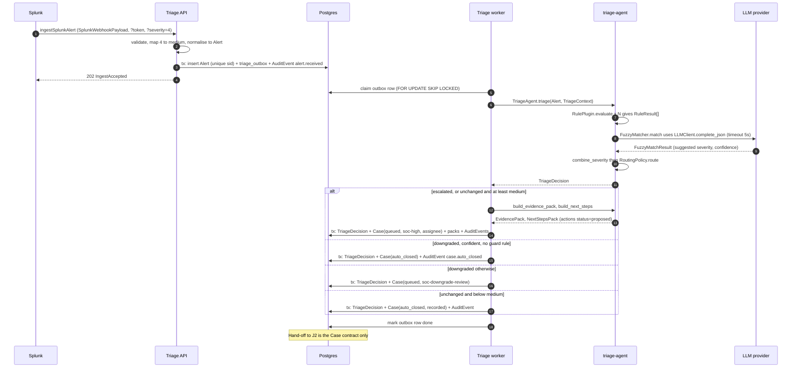

# Sequence J1: Alert ingestion and agentic triage

**Caption.** Time-ordered J1. Each message names the contract it exercises: `ingestSplunkAlert` /
`SplunkWebhookPayload` / `IngestAccepted` (schema validation, Schemathesis), the `TriageAgent`, `RulePlugin`,
`FuzzyMatcher`, `LLMClient`, `RoutingPolicy` Protocols (Protocol mocks; golden alerts), and the persisted
`TriageDecision`, `Case`, `EvidencePack`, `NextStepsPack`, `AuditEvent` schemas (producer-side validation).
Failure behaviour: ingest is idempotent on `sid`; the worker is idempotent on `alert_id` and retries via the
outbox lease; a fuzzy timeout falls back to rules only and never auto-closes.
