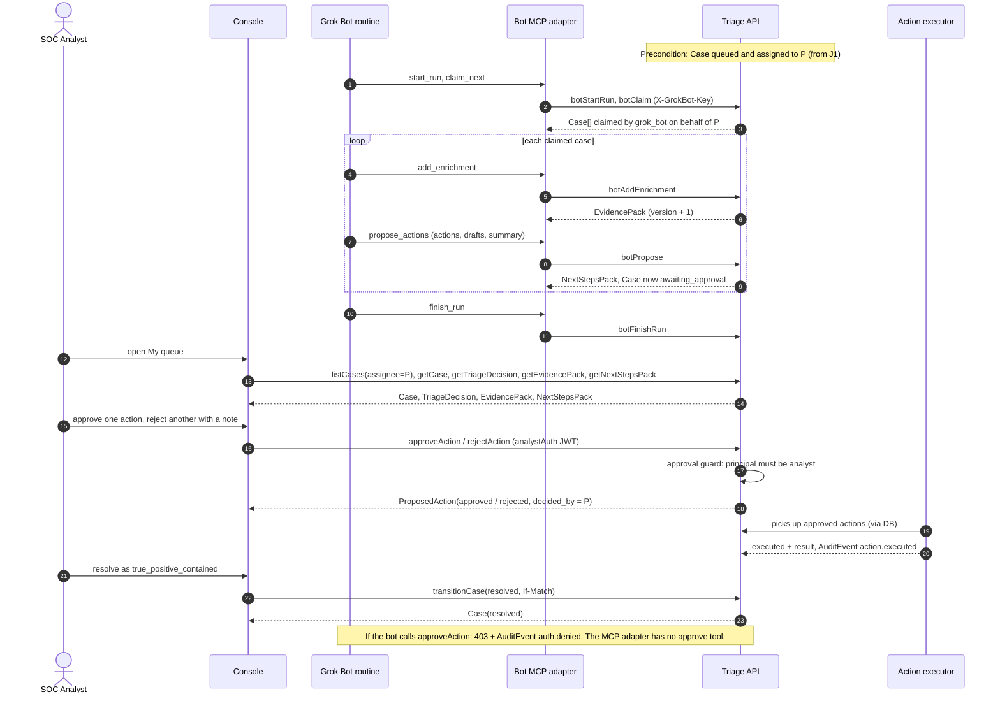

# Sequence J2: Analyst-assisted triage

**Caption.** Time-ordered J2: the bot run first, then the analyst's review. Bot calls use `botApiKey` and
are scoped to the analyst (`botStartRun`, `botClaim`, `botAddEnrichment`, `botPropose`, `botFinishRun`;
Schemathesis with a bot key, MCP tool tests vs Prism mock). Console calls use `analystAuth` (`listCases`,
`getCase`, `getTriageDecision`, `getEvidencePack`, `getNextStepsPack`, `approveAction`, `rejectAction`,
`transitionCase`; Pact consumer + Schemathesis provider). The human-approval invariant is enforced by the
API's approval guard, checked by the OpenAPI lint in the contract gate and by
`contracts/examples/invalid/action.bot-approved.json`. Open item: the bot reads evidence and next steps
through a proposed `botGetCaseBundle` (see `docs/architecture/contracts-map.md`).
