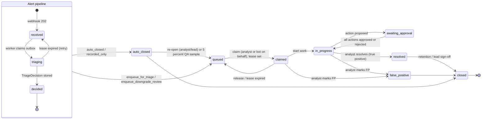
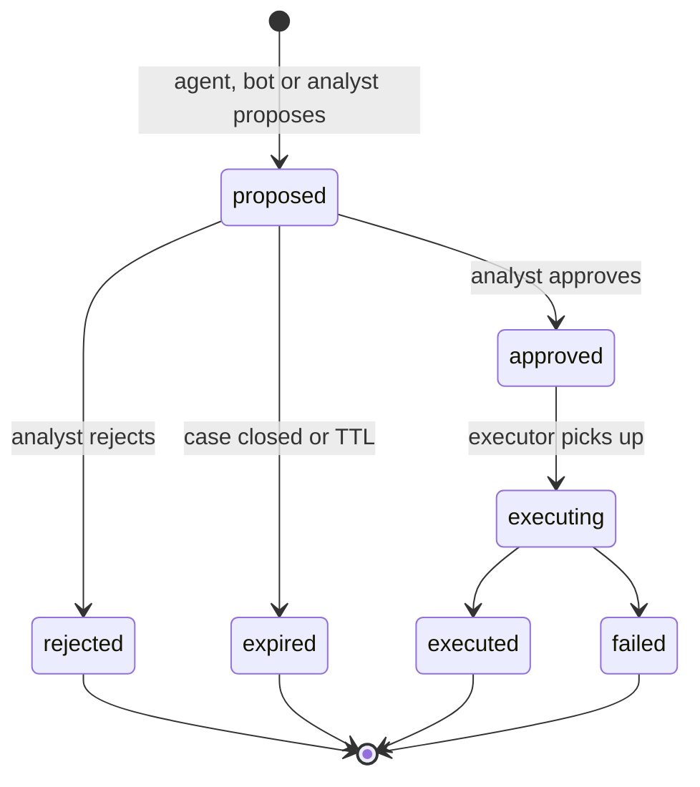

# State machine: alert / case lifecycle

Alert processing (pipeline) and case lifecycle (work item). Every transition emits an AuditEvent.
The API enforces exactly these transitions (409 otherwise).

| From → To | Who may do it |
|---|---|
| queued → claimed | analyst; grok_bot only if `assignee == on_behalf_of` |
| claimed → in_progress | claimant |
| in_progress → awaiting_approval | system, when an action enters `proposed` |
| awaiting_approval → in_progress | system, when no action is `proposed` |
| * → resolved / false_positive | **analyst only** |
| auto_closed → queued | analyst or lead |
| claimed → queued | claimant, or reaper on lease expiry |

## Action lifecycle

