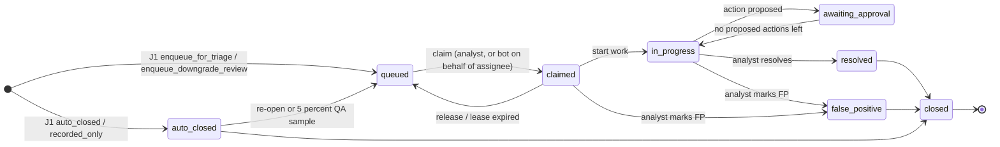
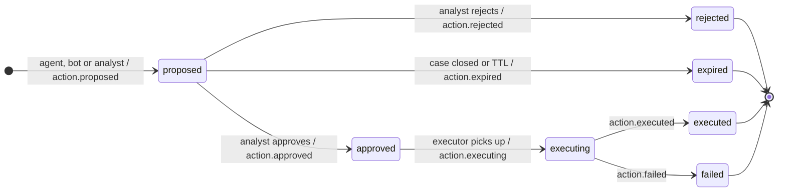

# State machines: case lifecycle and action lifecycle

The API enforces exactly these transitions (`transitionCase` returns 409 otherwise). Every transition emits an `AuditEvent`.

## Case lifecycle

**Caption.** Lifecycle of the `Case` object (`case.schema.json#/properties/status`). The two entry
transitions are J1's outcomes; everything after `queued` is J2. Implemented by the API's case state machine
component and exercised through `claimNext`, `botClaim`, `releaseCase`, `transitionCase`, `botPropose` and
`approveAction`/`rejectAction`. Verified by Schemathesis stateful runs (illegal transition → 409, stale
`If-Match` → 412) and unit tests on the state machine.

| From → To | Who may do it |
|---|---|
| queued → claimed | analyst; grok_bot only if `assignee == on_behalf_of` |
| claimed → in_progress | claimant |
| in_progress ↔ awaiting_approval | system, driven by action status |
| * → resolved / false_positive | **analyst only** |
| auto_closed → queued | analyst or lead |
| claimed → queued | claimant, or the reaper on lease expiry |

## Action lifecycle

**Caption.** Lifecycle of a `ProposedAction` (`action.schema.json#/properties/status`). Only an analyst can
move an action out of `proposed`. That rule is in the schema itself (decided statuses require
`decided_by.type = analyst`), proven by `contracts/examples/invalid/action.bot-approved.json`, enforced by the
API's approval guard (`approveAction`/`rejectAction` are `analystAuth`-only, linted by the contract gate), and
the executor only reads `approved` rows.

Each transition emits exactly one audit event of the matching type (`audit-event.schema.json#/properties/type`,
contract 0.2.1). There is one event type per status, so the audit trail never relabels a system transition as a
human one: a TTL or case-close expiry is `action.expired` (actor `system`), never `action.rejected`, and pickup by
the executor is `action.executing`, never `action.executed`.

| Action status | Audit event | Typical actor |
|---|---|---|
| `proposed` | `action.proposed` | triage_agent, grok_bot (on_behalf_of), analyst |
| `approved` | `action.approved` | analyst only |
| `rejected` | `action.rejected` | analyst only |
| `expired` | `action.expired` | system (expiry reaper or case close) |
| `executing` | `action.executing` | system (executor) |
| `executed` | `action.executed` | system (executor) |
| `failed` | `action.failed` | system (executor) |
